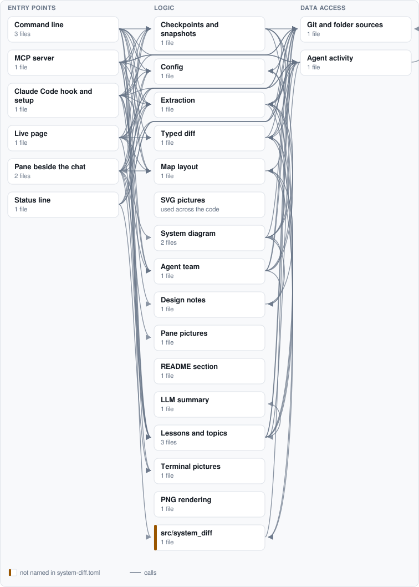

# system-diff

**See what Claude Code is doing to your system while it works, and learn your system as it goes.**

Claude Code edits files; system-diff tells you what those edits do to the *system*: which part Claude is working on
and what that part is, the endpoints, connections, stored data and outside systems it adds, changes or removes, why
each of those matters, and when one needs you to look before Claude goes on. Right in Claude Code, beside the chat.
So you follow what is happening, learn the parts and the technology behind them, and steer Claude well when it asks.

<!-- system-map:begin -->


<details><summary>How this map is made</summary>

Regenerated by `system-diff` from the code: the parts and their columns from `system-diff.toml`, the connections from imports, API calls and the settings each part reads, the outside systems from the settings a deploy configuration sets, and the tables from the migrations. Parts used everywhere are drawn without the arrows into them, and each part keeps only its strongest connections; `system-diff map` writes all of them to `system.json`.

Read by the code but set by no deploy configuration, so not drawn: Headless Chromium (Docker or Playwright) (png).

</details>
<!-- system-map:end -->

## In Claude Code

```sh
pipx install "system-diff[mcp,tui]"
system-diff setup claude --no-status-line   # the hooks, a skill and the MCP server (--scope project, --undo)
```

Then, in Claude Code, the System diff pane:

```
/plugin marketplace add simplifiedmachine/system-diff
/plugin install system-diff
```

Python 3.11 or newer. Claude Code opens the pane by itself when the terminal is wide enough; `/system-diff` opens
it again after you close it. (Should another marketplace you added also have a plugin called system-diff,
`/plugin install system-diff@system-diff` names this one.) From a clone, `claude --plugin-dir mods/system-diff`
loads it for one launch. Upgrading from an earlier version: run `system-diff setup claude` again; it updates the
hooks it added before, and frees `/system-diff` for the pane.

### The System diff pane

A tab beside Claude Code's own file diff: your system drawn the way a system designer draws it, live, with what
Claude is changing in it. `/system-diff close` (or "× close" in its tab row) hides it; `/system-diff` brings it back.

- **Now** follows Claude, in the order your attention needs it:
  - **What Claude is doing** ("● Claude is working ✎ Editing API") and what you asked.
  - **▲ Needs your attention**, only when something does. That means: an endpoint removed that a page still calls, a
    new way to change state, a dependency cycle, a dependency pointing up the layers, a new outside system inside a
    request, a table dropped, or a setting no deploy sets. Each comes with what it trades off and the question to ask
    Claude before it goes on.
  - **The system diagram**:
    - What it draws: who uses the system (people, programs, AI agents), where they come in, the containers that do
      the work with their components inside, and the data and outside systems it relies on. Flows join them, named
      for what they carry (HTTPS, MCP, SQL, a terminal).
    - Colours: Claude's component is lit in blue; what this turn added is green, changed yellow, removed red.
    - **Pick:** click the diagram, then ← ↑ ↓ → picks a box. Its flows in and out light up with the boxes at their
      other ends, and a line says what it uses and what uses it.
    - **Zoom:** Enter (or a second click) zooms in on a container's components, with the lines between them. `b` goes
      back, `f` follows Claude again.
    - **Scroll:** `[` `]` scroll a wide diagram across; shift ↑ ↓, Page Up/Down or the wheel scroll a tall one.
    - **Zoom:** ⊖ and ⊕ in the tab row (or `-` and `=`) draw the diagrams compact (narrower boxes, no flow labels) or
      tiny (titles only), to fit more of the system in a narrow pane; below 110 columns it is compact by itself.
  - **This turn**: each change to the design, and what it trades off.
  - **Learn**: how the part Claude works on is designed.
    - The principle its place calls for: an edge of the system, an adapter, a shared foundation, a coordinator.
    - Where it sits, and what to watch, such as cycles and layering.
    - The basics of a technology only where it is new: new to the system this turn, or one you marked new to you.
  - **What just happened**: the system diff, step by step. Each change an edit made is said in plain words, with why
    it matters and the file it came from. Edits that changed no structure are told once.
- **Review**: everything you have not marked as seen, across turns: the system diagram since your checkpoint with its
  changes coloured, every block to pick and zoom into, then every change read for design and the exact list. Once
  you have understood it, tell Claude "mark it as seen" (or run `system-diff checkpoint`): from then on you see only
  what is new to you.
- **Agents**: the team at work. Each agent's area, the blocks it owns and edited, and unread messages; the system
  diagram with `@agent` after each block it works on; the bus, newest first; and a warning when two agents edit one
  block, or one edits a block claimed for another.
- **Topics**: the stack, technology by technology. Pick one and the parts that use it light up in the diagram; space
  marks it new to you, so Learn explains its basics.

One meaning per colour, so your eye goes where it should:

- **Blue:** where Claude is and what you picked.
- **Yellow:** what changed and what needs you.
- **Green:** what is new, done or to learn.
- **White:** what to read.
- **Gray:** the background (why, when, labels).
- **Red:** only what was taken away.

`n` `r` `a` `t` switch views.

### A team of agents, by the system's blocks

Claude does most work alone unless asked otherwise, so system-diff asks it to plan a team:

- **Planning:** at each prompt, the hook tells Claude to call `plan_agents` with the task. The plan splits the task by
  the system's blocks, one agent per area it touches (a container, else a part). Each agent gets the blocks it owns
  (claimed for it), the blocks it depends on, and a brief to launch it with. Claude then launches the agents in
  parallel as subagents. Turn this off with `[agents] orchestrate = false` in `system-diff.toml`.
- **The bus:** an async publish/subscribe channel whose topics are the blocks. Each agent follows the blocks its own
  depend on. Every change an agent makes to a block's structure is published on that block's topic as it happens
  ("API no longer answers DELETE /orders/{id}"), with why it matters. Agents publish their own notes with `publish`
  (to a block, to "all", or to "agent:<name>"). Each agent's unread messages reach it with its next tool result
  of any kind (a read, an edit, a shell command, a search), once: nobody waits on anybody.
- **Claims:** `claim` gives an agent its blocks. An edit to someone else's block is published to its owner and shown
  under Needs your attention.
- **One agent, one area:** when an agent (the main conversation included) edits blocks in two or more areas in one
  turn, the edit hook tells it, once that turn, to plan a team with `plan_agents` and hand the rest to agents.

The MCP tools: `plan_agents`, `claim`, `publish`, `subscribe`, `inbox`, `team`. It all stays in `.git/system-diff/`
(`agents.json`, `bus.jsonl`), never pushed.

### In the conversation

- **After an edit that changes the system's structure**, one line under it: "System diff: API now answers GET
  /health · a new way in: it needs the same checks as the others". Edits that change no structure stay quiet.
- **Messages from other agents** on the bus arrive with an agent's next tool result of any kind, not only after
  an edit.
- **At the end of each turn**, one line on what the turn did to the system, or which parts it edited when the
  structure stayed the same; nothing for a turn that only talked.
- **Ask Claude** "what is the API part?" or "what does this change do?": the MCP server gives it `explain` (the facts
  to teach from, and a diagram to show you), `system_diff` (the exact list of changes; `base: turn` for this turn
  only), `system_map`, `draw` (pictures of a process or a sequence of calls) and `checkpoint` (mark what you have
  seen, so the next diff shows only what is new to you).

The pane and the hooks send nothing anywhere: the working tree is read as a snapshot (untracked files included)
without touching your index, HEAD or branches; the checkpoint and the start of each turn live under
`refs/worktree/system-diff/` (each worktree its own, for Claude sessions in parallel), and what the hooks note under
`.git/system-diff/`, never pushed. Only the optional lessons you ask an LLM for (`e` in the terminal view, `diff
--narrate`) go to your own LLM, and they carry the structure, never the code.

## Configuration

With no config, system-diff makes a first picture from the code:

- **Parts:** every folder of code is a part named by its path; tests and build tooling are left out.
- **Front end:** a front end goes under What people use, and the paths it calls are matched to the endpoints that
  answer them.
- **Data and outside systems:** databases and outside services are found from the compose file and the client
  libraries the code imports; tables from the migrations and the models.
- **Who uses it:** a front end's people, an API's callers, an MCP server's AI agents, a command line's developer.

A `system-diff.toml` at the repository root names the parts and says what is what:

```toml
tests = ["tests/**"]

[code]
roots = ["app/", "web/src/"]

[[actors]]                  # who uses the system, drawn first
id = "customers"
label = "Customers"
uses = ["web:browser"]      # part: what the flow carries

[[components]]
id = "api"
label = "API"
kind = "interface"          # ui | interface | logic | data: the column it is drawn in
group = "Backend"           # the container it is drawn in, with the others of its group
about = "orders and payments"
paths = ["app/api/**"]

[[externals]]
id = "postgres"
label = "PostgreSQL"
shape = "db"
env = ["DATABASE_URL"]      # the settings that reach it
```

Every key, and how the code is read: [the wiki](https://github.com/simplifiedmachine/system-diff/wiki).

## Add-ons

The same engine, outside the pane. Deterministic: the same code gives the same picture, byte for byte, and a part
that did not change keeps its place.

- **Pull requests:** every pull request gets its system diff as a comment, and CI fails when the README's map is out
  of date (`.github/workflows/system-diff.yml`, which you can copy). This repository runs it on itself.
- **Command line:**
  ```sh
  system-diff map --dir . --out docs/diagrams          # the system as it is now: system.json, system.svg
  system-diff diff --base origin/main --out out        # what this branch does to it: headline, plan, diff.svg
  system-diff diff --base HEAD --head . --out out      # what your uncommitted work does to it
  system-diff readme --json docs/diagrams/system.json  # keep the map in README.md current
  system-diff show API                                 # one part zoomed in, and what it is, in any terminal
  system-diff draw SPEC.json                           # hand-made pictures in the same look
  ```
  `diff --narrate` adds a plain-words summary from your own LLM; `[png]` adds PNG output.
- **Terminal view** (`system-diff tui`): the pane's views as a full-screen terminal app, for a terminal beside any
  agent. It opens by itself next to Claude Code in tmux, zellij, WezTerm, kitty and Windows Terminal; in VS Code,
  setup adds a task that opens it with the folder.
- **Status line** (`system-diff setup claude` without `--no-status-line`): the pane's first lines under Claude Code's
  prompt, for when the pane is not open.
- **Browser page** (`system-diff watch`): the same with the SVG pictures, at http://127.0.0.1:8765/.

## License

MIT
