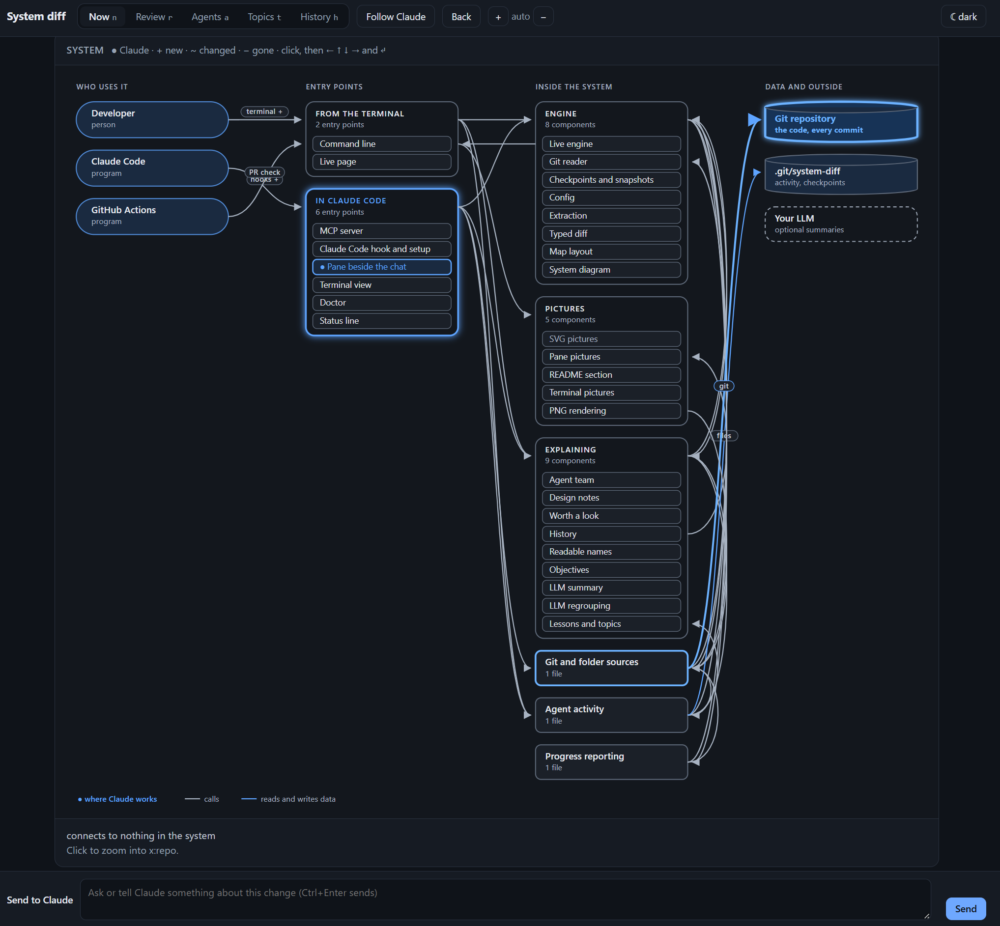
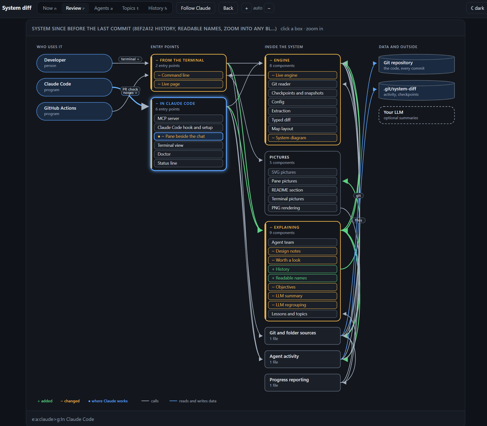
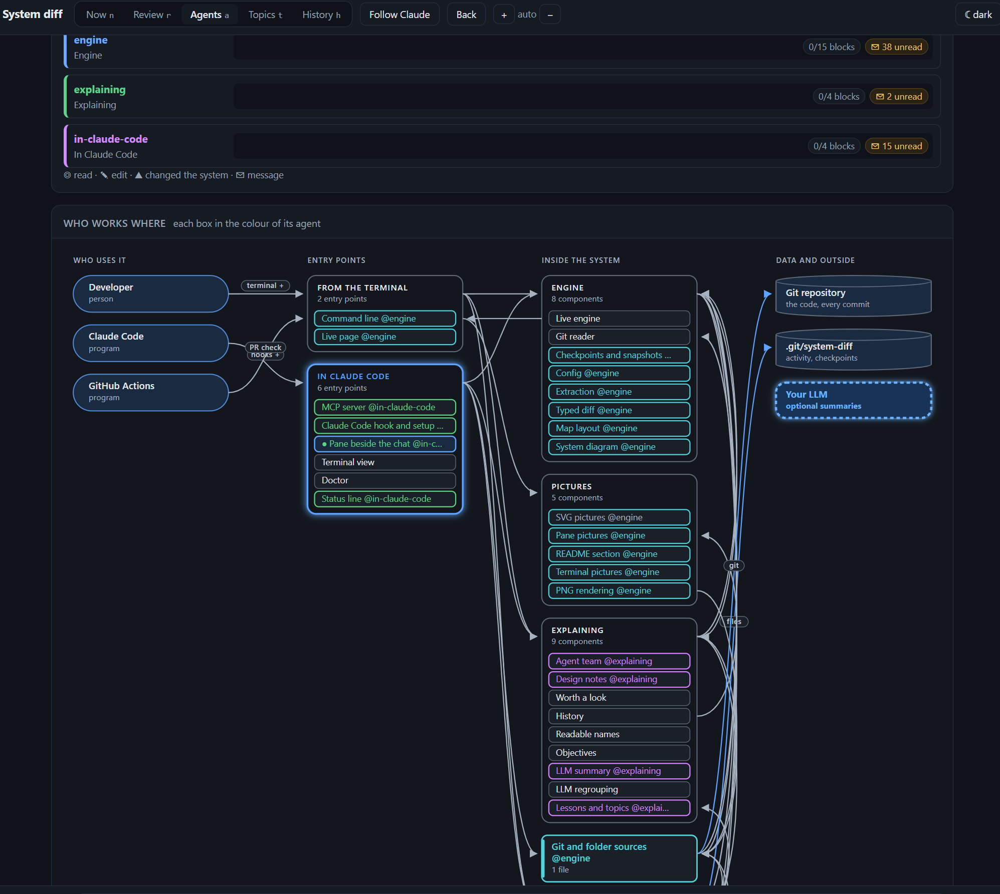
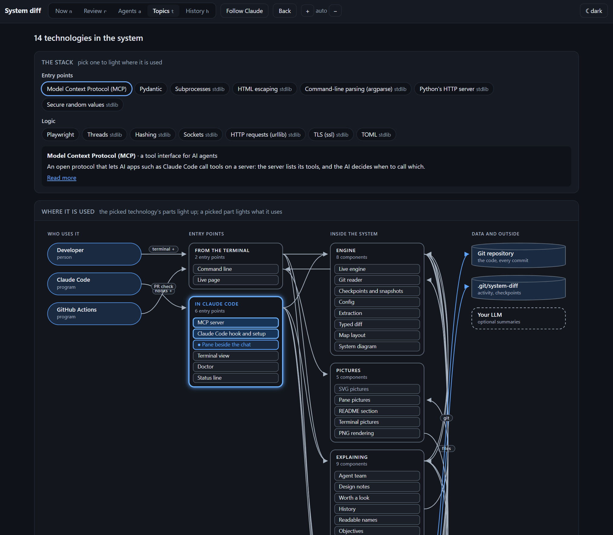

<div align="center">

# system-diff

### `git diff` shows you lines. **system-diff shows you what Claude just did to your system.**

[](https://pypi.org/project/system-diff/)
[](https://github.com/simplifiedmachine/system-diff/actions/workflows/ci.yml)
[](https://pypi.org/project/system-diff/)
[](https://github.com/simplifiedmachine/system-diff/blob/main/LICENSE)



</div>

AI agents now write code faster than any person can read it. One prompt, forty files changed, three hundred lines of
output, and a question at the end: *"Shall I go on?"* You say yes, because you can't tell. You are still in the loop,
but you are steering blind.

**system-diff keeps the human in the loop at the level that matters: the system.** While Claude Code works, it shows
the system the way a designer draws it (who uses it, where they come in, the parts inside, the data and outside
systems they rely on) and what each change does to it, in plain words: *a new call to Amazon S3, three new endpoints,
the API now reaching the database directly, past the logic layer.* What matters most comes first, with why it
matters. So you know what you are saying yes to.

## The vision

Version control gave us a history of **text**. As more of our software is written by agents, we need a history of
**design**: what changed in the system, who asked for it, which agent did it, and whether it still holds what we
care about. system-diff is a step towards that: a living, visual model of your system that every agent's work is
measured against, that you can read in a glance, and that teaches you as it goes.

The future we are building for: **people design, agents build, and nobody loses the plot.** Teams of agents working
in parallel on different blocks of a system, the person seeing all of it at once, the system's history told request
by request. If that future excites you, [come build it with us](#contributing).

## What you see

<table>
<tr>
<td width="50%"><a href="https://raw.githubusercontent.com/simplifiedmachine/system-diff/main/docs/screenshots/now.png"></a><br>
<b>Now</b>: the system, where Claude is working, and what is <b>worth a look</b>, ranked by consequence, each with why it matters.</td>
<td width="50%"><a href="https://raw.githubusercontent.com/simplifiedmachine/system-diff/main/docs/screenshots/review.png"></a><br>
<b>Review</b>: everything since you last looked: added, changed and removed, on the diagram.</td>
</tr>
<tr>
<td><a href="https://raw.githubusercontent.com/simplifiedmachine/system-diff/main/docs/screenshots/agents.png"></a><br>
<b>Agents</b>: a team of agents building in parallel, each on its own blocks, in its own colour, talking over a bus.</td>
<td><a href="https://raw.githubusercontent.com/simplifiedmachine/system-diff/main/docs/screenshots/topics.png"></a><br>
<b>Topics</b>: the stack, technology by technology; pick one and the parts that use it light up.</td>
</tr>
</table>

And **History**: how the system got here, step by step, as *"You asked: “add document uploads” → it got: a call to
Amazon S3, three endpoints under /flows/documents"*, for the whole system or any one block.

It lives in a pane beside the chat in Claude Code, in your browser at `http://localhost:8765/`, and in a terminal of
its own (`system-diff tui`). All three show the same live picture.

## Install

1. system-diff (Python 3.11+):
   ```sh
   pip install "system-diff[mcp,app]"     # or: pipx install "system-diff[mcp,app]"
   ```
2. Give Claude Code its tools, once for every repository:
   ```sh
   claude mcp add --scope user system-diff -- system-diff mcp             # macOS, Linux
   claude mcp add --scope user system-diff "--" python -m system_diff mcp # Windows PowerShell
   ```
   On Windows the `--` goes in quotes: PowerShell takes a bare `--` as the end of its own options and drops it
   (`claude` is a PowerShell script there), and `claude` then reads `-m` as its own: `error: unknown option '-m'`.
   Python itself, not `system-diff.exe`, so that nothing holds that file when you update (below).
   `claude mcp list` shows it connected.
3. In your repository, start it and open the page it prints:
   ```sh
   system-diff watch            # the web page, http://localhost:8765/
   system-diff app --open       # or the Studio, in the background: every project, and Claude Code sessions
   system-diff app --stop       # stops the Studio
   ```

**Optional: the Claude Code plugin**, for the pane beside the chat and the hooks that mark each turn and note each
edit as it happens (without them the page still follows every change, by watching the files):
```
/plugin marketplace add simplifiedmachine/system-diff#stable
/plugin install system-diff
```
The plugin brings the same MCP server, so with it skip step 2 (or remove it: `claude mcp remove system-diff`), and
the tools are not there twice. Restart Claude Code, and type `/system-diff` to open the pane; `/system-diff
autostart on` (or `/config`) opens it with every session.

Extensions install the same way beside it: `pip install research-diff` adds its tabs to the same page and its tools to
the same Studio sessions.

**Updating** is one command; it keeps your channel (stable, or nightly when you run a `.dev` version):
```sh
system-diff update             # macOS, Linux
python -m system_diff update   # Windows (system-diff update works too: it continues in a window of its own)
```
It stops what would block the install or keep running the old version (the Studio and the engines; on Windows also
anything still running `system-diff.exe`, after asking),
installs the latest, registers Claude Code's MCP server the right way for your machine (once: no second one beside the
plugin's), and updates the plugin. `--dry-run` shows what it would do; `--nightly` or `--stable` switches channel.
`system-diff stop` stops the Studio and every engine of yours (each starts again when needed).

**Stable and nightly.** The commands above install the latest [stable release](https://github.com/simplifiedmachine/system-diff/releases/latest)
(PyPI, and the plugin from the `stable` branch). To test what is coming, run nightly from `main`:
`pip install "system-diff[mcp,app] @ git+https://github.com/simplifiedmachine/system-diff@main"` and
`/plugin marketplace add simplifiedmachine/system-diff`. Bugs found there are very welcome as issues.

<details><summary>Windows, tmux, and a pane that opens above the chat</summary>

The pane sits beside the chat in Claude Code's fullscreen layout (110+ columns). Where it opens above the chat
instead, turn that layout on, then open a new terminal and start Claude Code again:

```
setx CLAUDE_CODE_NO_FLICKER 1                                    # Windows (PowerShell or cmd)
echo 'export CLAUDE_CODE_NO_FLICKER=1' >> ~/.bashrc              # macOS and Linux (~/.zshrc for zsh)
```

**Updating on Windows.** Windows cannot replace a program that is running, so a plain `pip install -U` fails with
`WinError 32 ... system-diff.exe` while something runs `system-diff.exe` (Claude Code's MCP server when it was added as
`system-diff mcp`, or the plugin's). `python -m system_diff update` stops those first, after asking; Claude Code
reconnects its tools with `/mcp`. The Studio, the engines and the pane run as `python -m system_diff` and never hold it.

On Windows, `python -m pip install "system-diff[mcp]"` works where `pip` is not on PATH. The plugin's MCP server is
started as `system-diff mcp`, directly (no shell), so the `system-diff` command must be on PATH: pip prints where it put
it (Python's `Scripts` folder) if that is not. If anything is slow or quiet, `python -m system_diff doctor` says why:
how long starting a program takes there, how long the hooks took, and why the engine last stopped.
</details>

## In Claude Code

- **The pane**: `n` Now · `r` Review · `a` Agents · `t` Topics · `h` History. Arrows pick a block (its connections
  light up), Enter zooms in, `b` goes back, `f` follows Claude. `/system-diff close` hides it, `/system-diff tui` opens
  it in a terminal of its own.
- **In the chat**: one line under an edit that changes the system's structure, and one at the end of the turn.
- **Ask Claude** "what is the API part?" or "what did this change do to the system?": it answers from system-diff's
  MCP tools, with a diagram.
- **Teams of agents**: for work that spans the system, Claude plans a team with `plan_agents`, one agent per block;
  they claim their blocks and tell each other what they change over a bus. A team can run in stages: an agent that
  uses what another one changes starts after it (`order="staged"`, or "web after api"). The Agents tab draws the
  **workflow**: a column per stage (agents in one run in parallel), arrows for who waits for whom, each agent's status
  (ready, waiting for…, running for 3m, done); click one for its session: the brief it got, what it said and did, its
  messages and files, live while it runs. Ask in the chat for another agent ("add a migrations agent after the API
  one": `add_agent`), and to keep a team for later ("save this as our feature workflow": `save_workflow`, for this
  project, a kind of project, or everywhere), then "run the feature workflow for …" (`run_workflow`). Extensions add
  their own steps, waits and agent kinds to the same view (research-diff's experiment runs, paper sections).
- **Objectives**: system-diff learns what you keep asking for ("fast on large repos", "must work on Windows"), shows
  it, keeps it in front of Claude and every agent, and marks changes that touch it. `x` clears one you disagree with.

Everything stays on your machine, under `.git/system-diff/`: never committed, never sent anywhere. The only exception
is the optional LLM features (regrouping the diagram, learning objectives, a file's summary when you open it), which
send structure (and, for a file's summary, that file's code with literal secrets masked) to the LLM your own Claude
Code already uses: the settings file and model chosen in the Studio for that project (or for all projects), else Claude
Code's own setup with a small model (haiku). `[narrate] model = "..."` in system-diff.toml picks another model. When
the LLM cannot be reached, the page says so in its conversation panel. `SYSTEM_DIFF_LLM=off` turns them off.

### Several projects

Each repository gets its own engine, on the first free port from 8765 (the first project you open is on 8765, the
next on 8766, and so on, up to 8774), and keeps serving only its own repository. The web page shows a row of project
tabs on top, one per running engine, with its branch and a dot when it changed since you last looked; a tab is a plain
link to that project's own page, in the same view (`[` and `]` switch). `system-diff hub` prints one address that
lists every running project (`http://localhost:8765/projects/page` while an engine runs there); bookmark it. Engines
list themselves in a folder of your own (`~/.local/state/system-diff/engines/`, `~/Library/Application
Support/system-diff/engines/` on macOS, `%LOCALAPPDATA%\system-diff\engines\` on Windows), without their tokens, and
remove themselves when they stop.

## How it works

- **A resident engine per repository** keeps your system in memory: parts, entry points, connections, settings,
  stored data and outside systems, read from the code (Python and TypeScript/JavaScript today: FastAPI, Flask,
  Express, Next.js, React, Vue, Svelte, SQLAlchemy, Alembic, Prisma, compose files…).
- **Edits arrive as events**: Claude's from its hooks, everyone else's from file times. Only changed files are read
  again, and git is read directly in Python, so a look takes about 0.1 s and an edit shows within a second, even in
  large repositories on slow machines.
- **Changes are ranked by consequence** (outside systems and data first, internals last) and said in plain words.
- **Deterministic**: the same code gives the same picture, byte for byte. The LLM only ever adds names and groupings,
  labelled as its proposals.

The design principles are in [docs/design.md](https://github.com/simplifiedmachine/system-diff/blob/main/docs/design.md).

## Configuration

With no config, system-diff makes a first picture from the code:

- **Parts:** every folder of code is a part named by its path; tests and build tooling are left out.
- **Front end:** a front end goes under What people use, and the paths it calls are matched to the endpoints that
  answer them.
- **Data and outside systems:** databases and outside services are found from the compose file and the client
  libraries the code imports; tables from the migrations and the models.
- **Who uses it:** a front end's people, an API's callers, an MCP server's AI agents, a command line's developer.

A `system-diff.toml` at the repository root names the parts and says what is what:

```toml
tests = ["tests/**"]

[code]
roots = ["app/", "web/src/"]

[[actors]]                  # who uses the system, drawn first
id = "customers"
label = "Customers"
uses = ["web:browser"]      # part: what the flow carries

[[components]]
id = "api"
label = "API"
kind = "interface"          # ui | interface | logic | data: the column it is drawn in
group = "Backend"           # the container it is drawn in, with the others of its group
about = "orders and payments"
paths = ["app/api/**"]

[[externals]]
id = "postgres"
label = "PostgreSQL"
shape = "db"
env = ["DATABASE_URL"]      # the settings that reach it
```

Every key, and how the code is read: [the wiki](https://github.com/simplifiedmachine/system-diff/wiki).

## Add-ons

The same engine, outside the pane. Deterministic: the same code gives the same picture, byte for byte, and a part
that did not change keeps its place.

- **Pull requests:** every pull request gets its system diff as a comment, and CI fails when the README's map is out
  of date (`.github/workflows/system-diff.yml`, which you can copy). This repository runs it on itself.
- **Command line:**
  ```sh
  system-diff map --dir . --out docs/diagrams          # the system as it is now: system.json, system.svg
  system-diff diff --base origin/main --out out        # what this branch does to it: headline, plan, diff.svg
  system-diff diff --base HEAD --head . --out out      # what your uncommitted work does to it
  system-diff readme --json docs/diagrams/system.json  # keep the map in README.md current
  system-diff show API                                 # one part zoomed in, and what it is, in any terminal
  system-diff draw SPEC.json                           # hand-made pictures in the same look
  ```
  `diff --narrate` adds a plain-words summary from your own LLM; `[png]` adds PNG output.
- **Status line** (`system-diff setup claude` without `--no-status-line`): the pane's first lines under Claude Code's
  prompt, for when the pane is not open.
- **Web page by hand** (`system-diff watch`): the pane's views in a browser, at http://localhost:8765/, without
  Claude Code.

## Extensions

Other packages can add views to system-diff's own engine, web page and pane (in the repositories they apply to:
research-diff's tabs where there is research; `extensions = false`, or a list of names, in `system-diff.toml`
decides for a repository), so one engine, one port, one page and one
pane serve them all, cached the same way and drawn with the same diagrams: research-diff's Evidence, Paper and
Auto-research tabs sit beside Now, Review, Agents, Topics and History. An extension declares itself in its
pyproject.toml:

```toml
[project.entry-points."system_diff.extensions"]
research = "research_diff.system_diff_ext"
```

and its module defines its views (`VIEWS`, `pane(ctx)`, `web(ctx)`), optionally routes of its own under `/x/<name>/`
(`route`), what it watches (`WATCH`), the files the page may show (`file_ok`), their outline and summary in the code
viewer (`outline`: a paper by its sections) and MCP tools (`mcp`). A view may pin a list on the left (`nav`: the
studies of a repository with several papers), and a diagram's file may open at given lines (`{"path", "line", "end"}`).
The contract is in
[src/system_diff/extensions.py](src/system_diff/extensions.py). `SYSTEM_DIFF_EXTENSIONS=off` loads none.

## Studio: work from one web app

```sh
pip install -U "system-diff[app]"     # brings the Claude Agent SDK; Claude Code itself must be installed
system-diff app --open
```

One local page for all your work: your projects on the left (each with its submodules and nested repositories
under it), the project's system-diff page in the middle (every tab, extensions' too), and a **Claude Code session**
beside it, run by the app with your own Claude Code login and gateway:

- Streaming answers, rendered as Markdown (lists, tables, code with a Copy button, links; raw HTML and script links
  stay text), tool calls as they happen, and a question card when a tool call needs your say (**Allow**,
  **Allow always**, **Deny** with a reason). When Claude Code asks anyway in `bypassPermissions` (an `ask` rule, a
  policy), the Studio allows it for you and notes why in the conversation; in other modes the card says why: its own reason, a subagent asking, an `ask` rule in your settings, or your organization's policy.
  In the message box, ↑ on the first line brings back what you sent in this project and ↓ goes forward to your draft. **Interrupt** stops a turn; a reload or a second tab replays the
  conversation; **Past conversations…** lists the project's earlier Claude Code conversations, like /resume, the ones open when the Studio stopped first ("Continue where you left off"); a resumed one shows what was said before. While Claude works, the line under the message box says what it is doing: the tool and its command or file, which subagent, how long, and when nothing has come from Claude Code for a minute.
- Dropdowns for the **settings** (Claude Code's own, or one settings file such as `~/.claude/settings.bedrock.json`;
  secrets never reach the page), the **model** (any alias or id) and the **permission mode** (`bypassPermissions` is
  never the default and shows red). Changing them mid-conversation starts a session that continues it. They are
  remembered per project; **Use for all projects** makes them every project's (a project's own change still wins
  there), and **Apply to open sessions** changes the model and permissions of the open ones at once.
- **Agents worth keeping, by kind of project**: roles your plans and subagents keep using (a tester, a reviewer, a
  citation checker) are suggested in the Agents tab, counted across all your projects. **Keep** saves one for this
  project (`.claude/agents/`), for every project of a kind (your library, `~/.claude/agent-library/`: research
  projects get the research agents, software projects the software ones), or everywhere. A project's kind is
  research when research-diff applies to it, software otherwise (`kind = "research"` in `system-diff.toml` says so).
  Studio sessions get their kind's agents at once; **Add to this repository** writes one into `.claude/agents/` for
  terminal sessions too. Claude can save them as well (`save_agent`, `save_skill`, `install_agents`).
- The diagrams follow the session as they follow a terminal one, and what you send from the page goes to the open
  session. One app per user (`system-diff app` again opens it); it uses each repository's own engine, so a terminal
  session in the same repository shares it. Every route checks the host name, the token and the page's origin.

**The team, readable.** On the Agents tab each subagent shows as what it does (its Task description), with its type
small; its row counts its work ("34 reads · 1 edit") and a click lists everything it did. Subagents Claude launches on
its own, without a plan, appear on the workflow board too: side by side when they ran at the same time, one after
another when one started once the other had finished, each with its status, duration and session log. A role Claude
keeps launching (two runs, here or across your projects) is offered to keep as an agent, with its prompt.

You can write while Claude works: the message waits as "queued" (edit or withdraw it until Claude takes it in) and
Claude takes it into the turn it is on, as a question it answers, a change of plan, or a task it hands to a subagent;
the message's line shows what became of it and the reply links back to it. **Stop & send** interrupts instead. Ask
Claude to keep a subagent that ran ("keep the survey agent") and `keep_agent` saves it as an agent from its prompt.

### Keys for your agents

A token your agents need (an Azure DevOps PAT to open a pull request, a GitHub token) is kept by system-diff, not
pasted into a chat. In the Studio: Session options → Keys → Add a key…, for this project or all projects. Or from a
terminal: `system-diff secrets set AZURE_DEVOPS_EXT_PAT [--all]` (the value is asked for, never shown);
`system-diff secrets list`; `system-diff secrets forget NAME`. Values are kept by your system: Windows' protected
storage (DPAPI), the macOS Keychain, the Secret Service keyring on Linux, or a file only you can read where there is
none. Every Studio session started afterwards gets them as environment variables (a session open when you add one
offers to restart with it, keeping the conversation). Claude is told their names, never their values, and a value
that shows up in output is masked on the page and in the session log. A key pasted into a message is caught before
sending: store it and send `$NAME` instead. `az devops` and `az repos` read `AZURE_DEVOPS_EXT_PAT` themselves.

Beside secrets, a project keeps settings that are not secret (a server's host or IP, a user name, a port), under a group
such as "staging server": sessions get them as environment variables and Claude is told their values. Write
"staging server 10.1.2.3 user deploy password …" in a message and the Studio offers to keep the host and user as
settings and the password as a secret. Claude can list and change settings (`project_settings`, `save_setting`) but
asks you for a secret's value in a password field (`ask_for_secret`), never in the chat. Keys → All projects, or
`system-diff secrets list --all-projects`, shows every project's entries without secret values;
`system-diff secrets set NAME --setting VALUE` keeps a setting from a terminal.

`system-diff doctor` says whether the app runs, its sessions, the Agent SDK and the `claude` it found;
`system-diff app --status` what the Studio sees: the engines registered (and whether each answers), its project list,
and every copy of system-diff on PATH.

## Claude sees and steers the page

The MCP server gives Claude the page as tools, in a terminal session as in the Studio: `ui_view` (what you are
looking at: the view, the part, the block you picked or hover), `ui_graph` (a view's diagram as data, extensions'
views too), `ui_source` (the files and the `system-diff.toml` entry behind a block), `ui_config_preview` (the diagram an
edit of the config would give, written nowhere) and `ui_show` (moves your page to what Claude explains, with a banner
offering Back; untick "Let Claude move my page" and it only offers). The diagrams stay computed from the code and the
config: Claude renames or groups a box by editing `system-diff.toml`, and the page redraws.

When a diagram looks wrong, say so in the chat. `ui_check` compares it with the code and names the cause: an import
through a path alias or a source folder the config does not know, code in no part, a part with no connections, a stale
config entry. Claude previews the `system-diff.toml` fix with `ui_config_preview` before editing it. What the config
cannot fix, `report_diagram_issue` keeps in `.git/system-diff/diagram-issues.jsonl` as a report to paste to
system-diff's maintainers, with secrets masked.

A view that takes long to draw never holds the page up: within three seconds you see the page drawn before, or
"Drawing …", and the view comes in when it is ready (the Studio never answers 502 for it).

## Projects inside a repository

A repository often holds several independent projects as plain folders: a monorepo's `api/`, `web/` and `worker/`
(each with its own `pyproject.toml`, `package.json`, `go.mod`...), or a research repository's studies. They are found
by what the folders hold, never by their names: a folder with its own manifest, or one an extension names (an
extension's `projects(ctx)` hook: research-diff's studies). The page lists them on the left under "Projects in this repository", with the whole repository first; a click draws
every tab for that folder (its parts, and the shared ones no project claims), from the same engine; the project stays
picked from tab to tab and on Back. It is the left column's one list: an extension's own lists come below it. Shared folders
(`scripts/`, `docs/`, `tests/`, ...) never count. **Show as one project** at the end of the list turns it off for the
repository (and **Split into N projects** back on); `projects = ["api", "web"]` in `system-diff.toml` names them, and
`projects = false` turns finding them off.

An extension can say what a repository opens on: a research repository opens on research-diff's tabs, with
system-diff's own behind one **System** tab.

## Repositories inside a repository

Git submodules and nested repositories (a folder with its own `.git`) are systems of their own. One that sits inside
a project's folder is part of that project, not a row of its own; the others are listed on the left, under the outer
repository, with their branch (by path when two share a name); a click opens that repository's own engine and
page (its own checkpoint, history and caches), and every repository of the family shows the same list, so you can go
back. In the outer repository's diagram each submodule is one box, at its commit, marked changed when its pointer
moves; an edit inside one reaches that repository's own engine too. Extensions get the outer repository as
`ctx.parent`.

## Roadmap

Where system-diff is going, also as a board: **[system-diff roadmap](https://github.com/users/simplifiedmachine/projects/1)**. Every item is an issue: comment on
it to take it on, or open a new one. Good places to
start are labelled [`good first issue`](https://github.com/simplifiedmachine/system-diff/labels/good%20first%20issue).

**Next: reach more systems**
- [ ] [Read language-agnostic system files (OpenAPI, GraphQL, compose, Kubernetes, Terraform, SQL, .env)](https://github.com/simplifiedmachine/system-diff/issues/1) (#1)
- [ ] [Go support](https://github.com/simplifiedmachine/system-diff/issues/2) (#2) · good first issue
- [ ] [Java/Kotlin (Spring) support](https://github.com/simplifiedmachine/system-diff/issues/3) (#3)
- [ ] [Add your language: a guide and a plug-in point for new languages](https://github.com/simplifiedmachine/system-diff/issues/4) (#4)
- [ ] [Better diagrams for large systems](https://github.com/simplifiedmachine/system-diff/issues/5) (#5)
- [ ] [Record how each connection was found, with a confidence](https://github.com/simplifiedmachine/system-diff/issues/26) (#26)

**Next: run well everywhere**
- [ ] [Hooks on Windows without sh](https://github.com/simplifiedmachine/system-diff/issues/6) (#6)
- [ ] [system-diff stop, and an idle timeout for engines](https://github.com/simplifiedmachine/system-diff/issues/7) (#7) · good first issue
- [ ] [History in the terminal view](https://github.com/simplifiedmachine/system-diff/issues/8) (#8) · good first issue
- [ ] [Follow renames through history](https://github.com/simplifiedmachine/system-diff/issues/9) (#9)
- [ ] [macOS in CI](https://github.com/simplifiedmachine/system-diff/issues/10) (#10) · good first issue

**Improve system-diff's own design**
- [ ] [The engine as the single source of truth](https://github.com/simplifiedmachine/system-diff/issues/11) (#11)
- [ ] [Layers, enforced by a test (system-diff checking its own design)](https://github.com/simplifiedmachine/system-diff/issues/12) (#12)
- [ ] [One view model, three renderers (split pane.py)](https://github.com/simplifiedmachine/system-diff/issues/13) (#13)
- [ ] [The web app as real files](https://github.com/simplifiedmachine/system-diff/issues/14) (#14) · good first issue
- [ ] [One background-job runner](https://github.com/simplifiedmachine/system-diff/issues/15) (#15)
- [ ] [One state store for .git/system-diff/](https://github.com/simplifiedmachine/system-diff/issues/16) (#16)
- [ ] [One schema for the page format](https://github.com/simplifiedmachine/system-diff/issues/17) (#17)
- [ ] [Graph tools for agents over MCP: find, neighbours, path, impact](https://github.com/simplifiedmachine/system-diff/issues/27) (#27)

**Then**
- [ ] [Other coding agents: Cursor, Codex CLI, Gemini CLI, Aider](https://github.com/simplifiedmachine/system-diff/issues/18) (#18)
- [ ] [Guardrails from objectives](https://github.com/simplifiedmachine/system-diff/issues/19) (#19)
- [ ] [Export to C4/Mermaid, and import a target architecture](https://github.com/simplifiedmachine/system-diff/issues/20) (#20)
- [ ] [Team mode: share objectives, checkpoints and history](https://github.com/simplifiedmachine/system-diff/issues/21) (#21)

**Later**
- [ ] [Replay a session](https://github.com/simplifiedmachine/system-diff/issues/22) (#22)
- [ ] [Design reviews in pull requests](https://github.com/simplifiedmachine/system-diff/issues/23) (#23)
- [ ] [Monorepos and multi-repo systems](https://github.com/simplifiedmachine/system-diff/issues/24) (#24)

## Contributing

system-diff is young, and the most useful things it could do haven't been built yet. Contributions of every size are
welcome: a bug report with the doctor's output, a new language, a better diagram layout, a sharper explanation of a
change, documentation, ideas.

- **Report a bug**: [open an issue](https://github.com/simplifiedmachine/system-diff/issues/new/choose) with what you
  did, what you expected, what happened, your OS and versions, and the output of `python -m system_diff doctor`.
  Screenshots of the pane or the web page help a lot.
- **Suggest a feature**: open an issue describing the problem it solves for you, or pick one from the roadmap.
- **Send a pull request**: read [CONTRIBUTING.md](https://github.com/simplifiedmachine/system-diff/blob/main/CONTRIBUTING.md) for the setup (a two-minute `pip install -e
  ".[dev]"`), how the code is laid out, and what a good PR looks like: tests with it, CI green on Linux and Windows,
  and the system map regenerated (`system-diff map --dir . --out docs/diagrams`). Your PR's comment shows what it does
  to system-diff's own design.

Good first issues are labelled [`good first issue`](https://github.com/simplifiedmachine/system-diff/labels/good%20first%20issue).

## License

MIT. See [LICENSE](https://github.com/simplifiedmachine/system-diff/blob/main/LICENSE).
