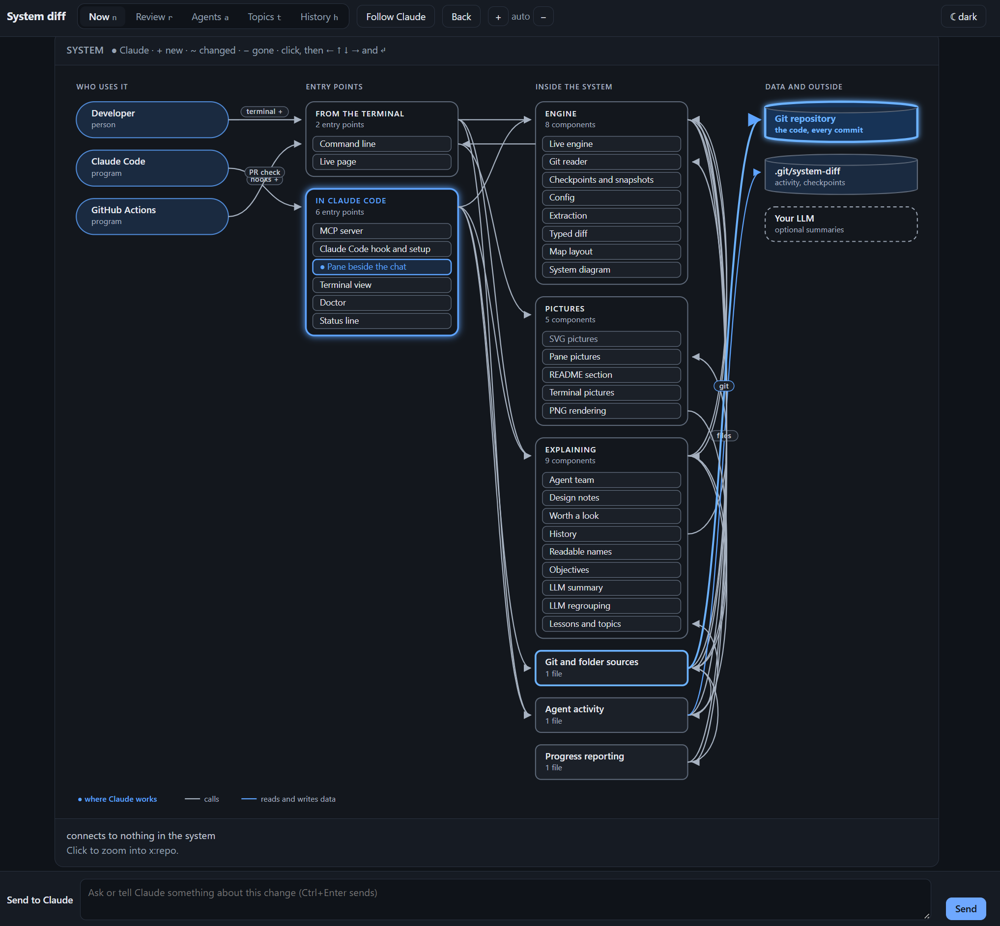
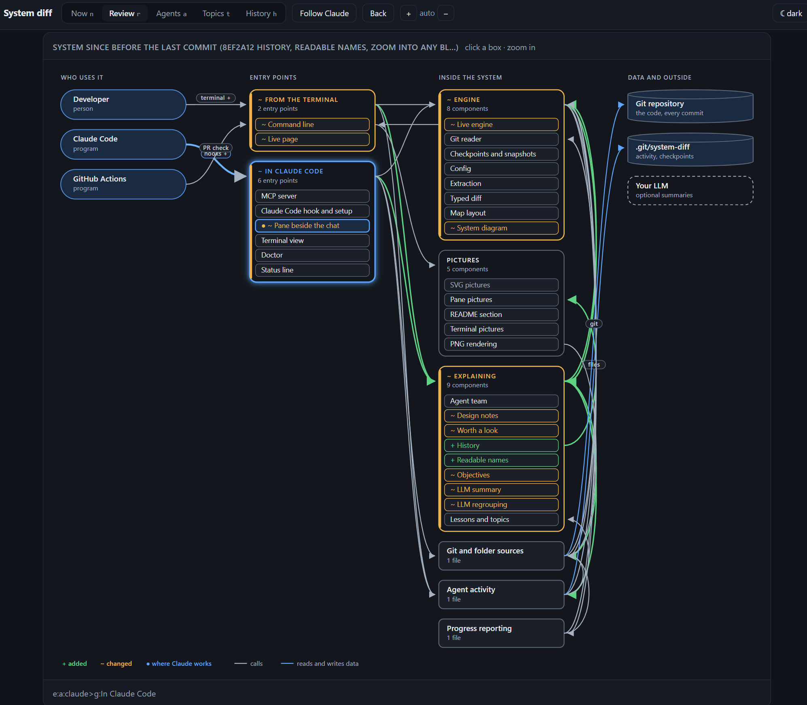
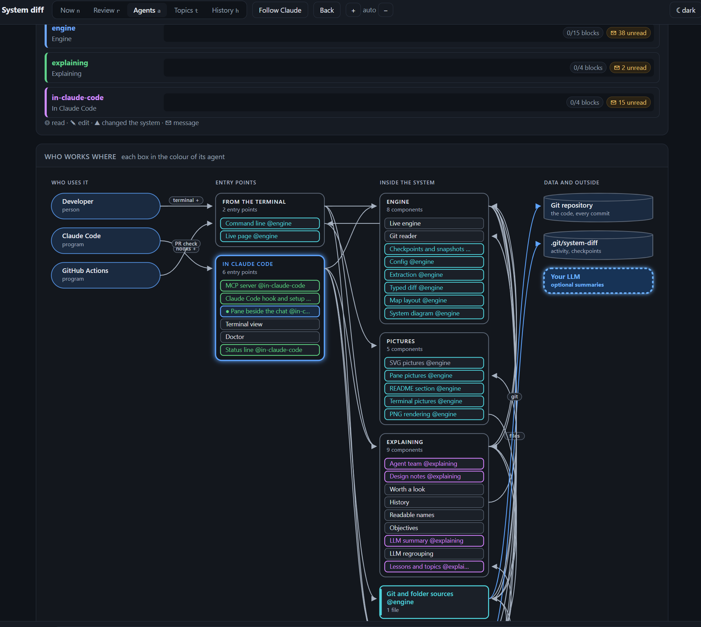
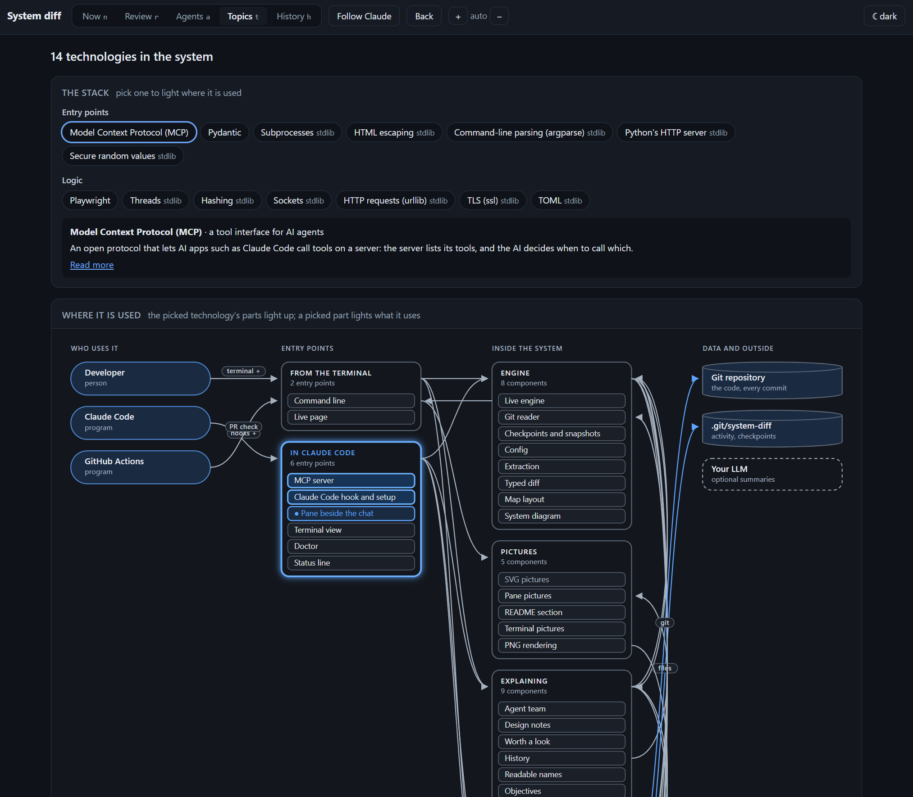

<div align="center">

# system-diff

### `git diff` shows you lines. **system-diff shows you what Claude just did to your system.**

[](https://pypi.org/project/system-diff/)
[](https://github.com/simplifiedmachine/system-diff/actions/workflows/ci.yml)
[](https://pypi.org/project/system-diff/)
[](https://github.com/simplifiedmachine/system-diff/blob/main/LICENSE)



</div>

AI agents now write code faster than any person can read it. One prompt, forty files changed, three hundred lines of
output, and a question at the end: *"Shall I go on?"* You say yes, because you can't tell. You are still in the loop,
but you are steering blind.

**system-diff keeps the human in the loop at the level that matters: the system.** While Claude Code works, it shows
the system the way a designer draws it (who uses it, where they come in, the parts inside, the data and outside
systems they rely on) and what each change does to it, in plain words: *a new call to Amazon S3, three new endpoints,
the API now reaching the database directly, past the logic layer.* What matters most comes first, with why it
matters. So you know what you are saying yes to.

## The vision

Version control gave us a history of **text**. As more of our software is written by agents, we need a history of
**design**: what changed in the system, who asked for it, which agent did it, and whether it still holds what we
care about. system-diff is a step towards that: a living, visual model of your system that every agent's work is
measured against, that you can read in a glance, and that teaches you as it goes.

The future we are building for: **people design, agents build, and nobody loses the plot.** Teams of agents working
in parallel on different blocks of a system, the person seeing all of it at once, the system's history told request
by request. If that future excites you, [come build it with us](#contributing).

## What you see

<table>
<tr>
<td width="50%"><a href="https://raw.githubusercontent.com/simplifiedmachine/system-diff/main/docs/screenshots/now.png"></a><br>
<b>Now</b>: the system, where Claude is working, and what is <b>worth a look</b>, ranked by consequence, each with why it matters.</td>
<td width="50%"><a href="https://raw.githubusercontent.com/simplifiedmachine/system-diff/main/docs/screenshots/review.png"></a><br>
<b>Review</b>: everything since you last looked: added, changed and removed, on the diagram.</td>
</tr>
<tr>
<td><a href="https://raw.githubusercontent.com/simplifiedmachine/system-diff/main/docs/screenshots/agents.png"></a><br>
<b>Agents</b>: a team of agents building in parallel, each on its own blocks, in its own colour, talking over a bus.</td>
<td><a href="https://raw.githubusercontent.com/simplifiedmachine/system-diff/main/docs/screenshots/topics.png"></a><br>
<b>Topics</b>: the stack, technology by technology; pick one and the parts that use it light up.</td>
</tr>
</table>

And **History**: how the system got here, step by step, as *"You asked: “add document uploads” → it got: a call to
Amazon S3, three endpoints under /flows/documents"*, for the whole system or any one block.

It lives in a pane beside the chat in Claude Code, in your browser at `http://localhost:8765/`, and in a terminal of
its own (`system-diff tui`). All three show the same live picture.

## Install

1. The engine (Python 3.11+):
   ```sh
   pip install "system-diff[mcp]"        # or: pipx install "system-diff[mcp]"
   ```
2. The plugin, in Claude Code:
   ```
   /plugin marketplace add simplifiedmachine/system-diff
   /plugin install system-diff
   ```
3. Restart Claude Code. The pane opens beside the chat; `/system-diff` opens it again.

<details><summary>Windows, tmux, and a pane that opens above the chat</summary>

The pane sits beside the chat in Claude Code's fullscreen layout (110+ columns). Where it opens above the chat
instead, turn that layout on, then open a new terminal and start Claude Code again:

```
setx CLAUDE_CODE_NO_FLICKER 1                                    # Windows (PowerShell or cmd)
echo 'export CLAUDE_CODE_NO_FLICKER=1' >> ~/.bashrc              # macOS and Linux (~/.zshrc for zsh)
```

On Windows, `python -m pip install "system-diff[mcp]"` works where `pip` is not on PATH. If anything is slow or quiet,
`python -m system_diff doctor` says why.
</details>

## In Claude Code

- **The pane**: `n` Now · `r` Review · `a` Agents · `t` Topics · `h` History. Arrows pick a block (its connections
  light up), Enter zooms in, `b` goes back, `f` follows Claude. `/system-diff close` hides it, `/system-diff tui` opens
  it in a terminal of its own.
- **In the chat**: one line under an edit that changes the system's structure, and one at the end of the turn.
- **Ask Claude** "what is the API part?" or "what did this change do to the system?": it answers from system-diff's
  MCP tools, with a diagram.
- **Teams of agents**: for work that spans the system, Claude plans a team with `plan_agents`, one agent per block;
  they claim their blocks and tell each other what they change over a bus. Watch them in the Agents tab.
- **Objectives**: system-diff learns what you keep asking for ("fast on large repos", "must work on Windows"), shows
  it, keeps it in front of Claude and every agent, and marks changes that touch it. `x` clears one you disagree with.

Everything stays on your machine, under `.git/system-diff/`: never committed, never sent anywhere. The only exception
is the optional LLM features (regrouping the diagram, learning objectives), which send structure, never code, to the
LLM your own Claude Code already uses. `SYSTEM_DIFF_LLM=off` turns them off.

## How it works

- **A resident engine per repository** keeps your system in memory: parts, entry points, connections, settings,
  stored data and outside systems, read from the code (Python and TypeScript/JavaScript today: FastAPI, Flask,
  Express, Next.js, React, Vue, Svelte, SQLAlchemy, Alembic, Prisma, compose files…).
- **Edits arrive as events**: Claude's from its hooks, everyone else's from file times. Only changed files are read
  again, and git is read directly in Python, so a look takes about 0.1 s and an edit shows within a second, even in
  large repositories on slow machines.
- **Changes are ranked by consequence** (outside systems and data first, internals last) and said in plain words.
- **Deterministic**: the same code gives the same picture, byte for byte. The LLM only ever adds names and groupings,
  labelled as its proposals.

The design principles are in [docs/design.md](https://github.com/simplifiedmachine/system-diff/blob/main/docs/design.md).

## Configuration

With no config, system-diff makes a first picture from the code:

- **Parts:** every folder of code is a part named by its path; tests and build tooling are left out.
- **Front end:** a front end goes under What people use, and the paths it calls are matched to the endpoints that
  answer them.
- **Data and outside systems:** databases and outside services are found from the compose file and the client
  libraries the code imports; tables from the migrations and the models.
- **Who uses it:** a front end's people, an API's callers, an MCP server's AI agents, a command line's developer.

A `system-diff.toml` at the repository root names the parts and says what is what:

```toml
tests = ["tests/**"]

[code]
roots = ["app/", "web/src/"]

[[actors]]                  # who uses the system, drawn first
id = "customers"
label = "Customers"
uses = ["web:browser"]      # part: what the flow carries

[[components]]
id = "api"
label = "API"
kind = "interface"          # ui | interface | logic | data: the column it is drawn in
group = "Backend"           # the container it is drawn in, with the others of its group
about = "orders and payments"
paths = ["app/api/**"]

[[externals]]
id = "postgres"
label = "PostgreSQL"
shape = "db"
env = ["DATABASE_URL"]      # the settings that reach it
```

Every key, and how the code is read: [the wiki](https://github.com/simplifiedmachine/system-diff/wiki).

## Add-ons

The same engine, outside the pane. Deterministic: the same code gives the same picture, byte for byte, and a part
that did not change keeps its place.

- **Pull requests:** every pull request gets its system diff as a comment, and CI fails when the README's map is out
  of date (`.github/workflows/system-diff.yml`, which you can copy). This repository runs it on itself.
- **Command line:**
  ```sh
  system-diff map --dir . --out docs/diagrams          # the system as it is now: system.json, system.svg
  system-diff diff --base origin/main --out out        # what this branch does to it: headline, plan, diff.svg
  system-diff diff --base HEAD --head . --out out      # what your uncommitted work does to it
  system-diff readme --json docs/diagrams/system.json  # keep the map in README.md current
  system-diff show API                                 # one part zoomed in, and what it is, in any terminal
  system-diff draw SPEC.json                           # hand-made pictures in the same look
  ```
  `diff --narrate` adds a plain-words summary from your own LLM; `[png]` adds PNG output.
- **Status line** (`system-diff setup claude` without `--no-status-line`): the pane's first lines under Claude Code's
  prompt, for when the pane is not open.
- **Web page by hand** (`system-diff watch`): the pane's views in a browser, at http://localhost:8765/, without
  Claude Code.

## Roadmap

Where system-diff is going. Every item is an issue: comment on it to take it on, or open a new one. Good places to
start are labelled [`good first issue`](https://github.com/simplifiedmachine/system-diff/labels/good%20first%20issue).

**Next: reach more systems**
- [ ] [Read language-agnostic system files (OpenAPI, GraphQL, compose, Kubernetes, Terraform, SQL, .env)](https://github.com/simplifiedmachine/system-diff/issues/1) (#1)
- [ ] [Go support](https://github.com/simplifiedmachine/system-diff/issues/2) (#2) · good first issue
- [ ] [Java/Kotlin (Spring) support](https://github.com/simplifiedmachine/system-diff/issues/3) (#3)
- [ ] [Add your language: a guide and a plug-in point for new languages](https://github.com/simplifiedmachine/system-diff/issues/4) (#4)
- [ ] [Better diagrams for large systems](https://github.com/simplifiedmachine/system-diff/issues/5) (#5)

**Next: run well everywhere**
- [ ] [Hooks on Windows without sh](https://github.com/simplifiedmachine/system-diff/issues/6) (#6)
- [ ] [system-diff stop, and an idle timeout for engines](https://github.com/simplifiedmachine/system-diff/issues/7) (#7) · good first issue
- [ ] [History in the terminal view](https://github.com/simplifiedmachine/system-diff/issues/8) (#8) · good first issue
- [ ] [Follow renames through history](https://github.com/simplifiedmachine/system-diff/issues/9) (#9)
- [ ] [macOS in CI](https://github.com/simplifiedmachine/system-diff/issues/10) (#10) · good first issue

**Improve system-diff's own design**
- [ ] [The engine as the single source of truth](https://github.com/simplifiedmachine/system-diff/issues/11) (#11)
- [ ] [Layers, enforced by a test (system-diff checking its own design)](https://github.com/simplifiedmachine/system-diff/issues/12) (#12)
- [ ] [One view model, three renderers (split pane.py)](https://github.com/simplifiedmachine/system-diff/issues/13) (#13)
- [ ] [The web app as real files](https://github.com/simplifiedmachine/system-diff/issues/14) (#14) · good first issue
- [ ] [One background-job runner](https://github.com/simplifiedmachine/system-diff/issues/15) (#15)
- [ ] [One state store for .git/system-diff/](https://github.com/simplifiedmachine/system-diff/issues/16) (#16)
- [ ] [One schema for the page format](https://github.com/simplifiedmachine/system-diff/issues/17) (#17)

**Then**
- [ ] [Other coding agents: Cursor, Codex CLI, Gemini CLI, Aider](https://github.com/simplifiedmachine/system-diff/issues/18) (#18)
- [ ] [Guardrails from objectives](https://github.com/simplifiedmachine/system-diff/issues/19) (#19)
- [ ] [Export to C4/Mermaid, and import a target architecture](https://github.com/simplifiedmachine/system-diff/issues/20) (#20)
- [ ] [Team mode: share objectives, checkpoints and history](https://github.com/simplifiedmachine/system-diff/issues/21) (#21)

**Later**
- [ ] [Replay a session](https://github.com/simplifiedmachine/system-diff/issues/22) (#22)
- [ ] [Design reviews in pull requests](https://github.com/simplifiedmachine/system-diff/issues/23) (#23)
- [ ] [Monorepos and multi-repo systems](https://github.com/simplifiedmachine/system-diff/issues/24) (#24)

## Contributing

system-diff is young, and the most useful things it could do haven't been built yet. Contributions of every size are
welcome: a bug report with the doctor's output, a new language, a better diagram layout, a sharper explanation of a
change, documentation, ideas.

- **Report a bug**: [open an issue](https://github.com/simplifiedmachine/system-diff/issues/new/choose) with what you
  did, what you expected, what happened, your OS and versions, and the output of `python -m system_diff doctor`.
  Screenshots of the pane or the web page help a lot.
- **Suggest a feature**: open an issue describing the problem it solves for you, or pick one from the roadmap.
- **Send a pull request**: read [CONTRIBUTING.md](https://github.com/simplifiedmachine/system-diff/blob/main/CONTRIBUTING.md) for the setup (a two-minute `pip install -e
  ".[dev]"`), how the code is laid out, and what a good PR looks like: tests with it, CI green on Linux and Windows,
  and the system map regenerated. system-diff draws its own architecture below; your PR's comment shows what it does
  to it.

Good first issues are labelled [`good first issue`](https://github.com/simplifiedmachine/system-diff/labels/good%20first%20issue).

## system-diff, drawn by itself

<!-- system-map:begin -->


<details><summary>How this map is made</summary>

Regenerated by `system-diff` from the code: the parts and their columns from `system-diff.toml`, the connections from imports, API calls and the settings each part reads, the outside systems from the settings a deploy configuration sets, and the tables from the migrations. Parts used everywhere are drawn without the arrows into them, and each part keeps only its strongest connections; `system-diff map` writes all of them to `system.json`.

Read by the code but set by no deploy configuration, so not drawn: Headless Chromium (Docker or Playwright) (png).

</details>
<!-- system-map:end -->

## License

MIT. See [LICENSE](https://github.com/simplifiedmachine/system-diff/blob/main/LICENSE).
